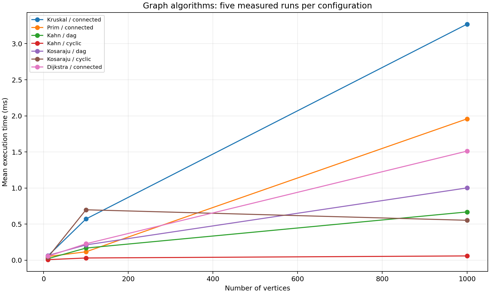
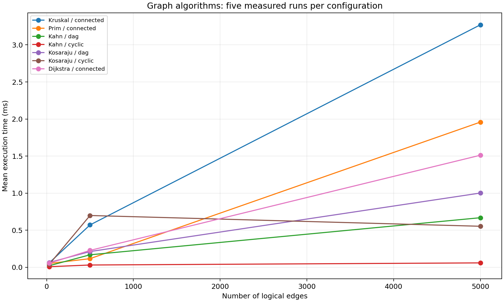

# Assignment 3 — Smart City Infrastructure and Route Planning

## 1. Overview

This Java application represents a city's infrastructure as a weighted graph. Vertices represent districts or locations; edges represent roads or infrastructure connections. Weights represent construction costs for infrastructure planning or travel distances for route planning.

The application implements Kruskal and Prim for minimum spanning trees (MSTs), Kahn for topological ordering, Kosaraju for strongly connected components (SCCs), and Dijkstra for shortest paths.

## 2. Implementation

### Graph representation

`Graph` stores vertices in a dynamically resized `Node[]`. Each node contains an `Edge[]` adjacency array and a logical size. Algorithms iterate up to that logical size to avoid unused null slots. Vertex IDs are integers from 0 to V−1.

Each edge contains `from`, `to`, and `weight`. Directed edges have one adjacency entry; undirected edges have two, one for each direction. The representation uses O(V+E) space. For Kruskal, collecting only entries with `from < to` avoids duplicate undirected edges and excludes self-loops, which cannot belong to an MST.

### Algorithms and design decisions

- **DSU:** A parent array represents disjoint sets, while a size array tracks component sizes at roots. Path compression points visited vertices directly to their root. Union by size attaches the smaller tree below the larger one. Root IDs must be swapped when necessary, not the values in the size array.
- **Kruskal:** Collect and sort edges by increasing weight. Accept an edge only when its endpoints belong to different DSU components, then merge those components. Fresh DSU and MST storage are created for each invocation so repeated experiments remain valid.
- **Prim:** Grow one tree from a starting vertex. A priority queue holds candidate edges ordered by weight. Accept an edge only if its destination has not been visited; skip obsolete edges whose destinations are already in the tree.
- **Kahn:** Compute indegrees and place zero-indegree vertices in a priority queue. Remove a vertex and decrease only its outgoing neighbours' indegrees. If fewer than V vertices are processed, the graph contains a cycle. The priority queue chooses the smallest available vertex ID.
- **Kosaraju:** Run DFS to record finishing order, reverse all edges, and run DFS again in decreasing finishing order. Each new DFS in the reversed graph identifies an SCC. Component and vertex output order may vary without changing the partition.
- **Dijkstra:** Maintain shortest known distances and predecessor vertices. A priority queue orders entries by total distance from the source. Relax outgoing edges and skip stale queue entries. `long` distances avoid ordinary 32-bit path-sum overflow. Unreachable vertices retain `Long.MAX_VALUE`.

Dijkstra requires non-negative weights: a negative edge can improve a distance after the greedy algorithm would normally regard it as final. The implementation rejects negative weights. MST algorithms can use negative weights.

The benchmark version uses a `quiet` flag to disable output and retains Dijkstra and SCC results for checks. Edge and DSU counters measure selected operations.

## 3. Complexity Analysis

Let V be the number of vertices and E the number of logical edges. Undirected graphs store 2E adjacency entries. The following bounds describe the supplied adjacency-array implementations and Java priority queues, excluding console output and reconstruction of every shortest path.

| Operation / algorithm | Time | Auxiliary space | Explanation |
|---|---|---|---|
| DSU initialization | O(V) total | O(V) | Initialize parents and component sizes; arrays grow geometrically |
| DSU find / union | O(α(V)) amortized | O(log V) recursion for find | Path compression and union by size; O(log V) worst-case single operation under these invariants |
| Kruskal | O(V + E log(E+1) + Eα(V)) | O(V+E) | Collect edges, sort, initialize DSU, and process edges |
| Prim, lazy edge queue | O(V + E log(E+1)) | O(V+E) | Queue can contain O(E) candidate edges |
| Kahn, priority queue | O(E + V log(V+1)) | O(V) | Scan edges and insert/remove vertices from the heap |
| Kosaraju | O(V+E) | O(V+E) | Two DFS passes plus reversed graph; recursion depth up to O(V) |
| Dijkstra, duplicate-entry queue | O(V + E log(E+1)) | O(V+E) | Validation and relaxation scans, with up to O(E) queue entries |

α is the inverse Ackermann function, which grows extremely slowly. DSU is therefore nearly constant time per operation over a sequence, but not a strict O(1) worst-case operation.

For connected simple graphs, the usual simplified Prim and Dijkstra bound is O(E log V). A FIFO queue would make Kahn O(V+E), but the current implementation uses a priority queue. Increasing V increases initialization and vertex-processing work; increasing E increases scans, sorting and queue activity. Printing every reconstructed shortest path can add O(V²) work in a chain graph and is excluded from timing.

## 4. Experimental Setup

| Configuration | V | E |
|---|---:|---:|
| Small | 10 | 30 |
| Medium | 100 | 500 |
| Large | 1,000 | 5,000 |

The benchmark uses `Random(42)`, three untimed warm-up calls and five measured repetitions per configuration. Elapsed time is measured with `System.nanoTime()`. The arithmetic mean of five times is reported. There are 21 configurations and 105 measured runs.

### Graph generation

- **Connected undirected graphs:** Connect each vertex after the first to a random earlier vertex, creating a spanning tree. Add random edges until exactly E logical edges exist. Kruskal, Prim and Dijkstra use this graph; Dijkstra starts at vertex 0.
- **DAGs:** Generate directed edges only from smaller to larger vertex IDs. Kahn and Kosaraju use these graphs. Every SCC is a singleton.
- **Cyclic directed graphs:** Begin with a directed ring through all vertices, then add random edges to reach E. The graph has one SCC, and every vertex initially has positive indegree. Kahn therefore detects the cycle without processing any vertices.

Weights are integers from 1 to 100. Duplicate weights are allowed; duplicate logical edges and self-loops are excluded from generated experiments. All algorithms at a given workload reuse the same graph across repetitions.

Graph generation, correctness checks and output are outside the timed region. Kruskal timing includes collection, sorting and fresh DSU initialization. Kosaraju includes reversal. Dijkstra includes negative-weight validation and predecessor recording, but excludes path printing. Counter overhead and algorithm-specific allocations remain inside timing.

### Execution environment

| Property | Recorded value |
|---|---|
| Java | 26.0.1 |
| Virtual machine | OpenJDK 64-Bit Server VM |
| Operating system | Windows 11 amd64 |
| Available logical processors | 16 |
| Random seed | 42 |
| Warm-ups / measured repetitions | 3 / 5 |

These values and the measurements are taken from the supplied run, not from a different machine. CPU model and memory capacity were not recorded.

## 5. Results

### Average execution time

All values below are **milliseconds**, converted from the submitted nanosecond measurements.

| Algorithm | Graph | V=10, E=30 | V=100, E=500 | V=1,000, E=5,000 |
|---|---|---:|---:|---:|
| Kruskal | connected | 0.05926 | 0.57094 | 3.27060 |
| Prim | connected | 0.05070 | 0.11602 | 1.95808 |
| Kahn | dag | 0.02090 | 0.16796 | 0.66834 |
| Kahn | cyclic | 0.00754 | 0.03040 | 0.05894 |
| Kosaraju | dag | 0.06456 | 0.21180 | 1.00126 |
| Kosaraju | cyclic | 0.03996 | 0.69828 | 0.55298 |
| Dijkstra | connected | 0.05428 | 0.22748 | 1.51122 |

### Recorded edge examinations

| Algorithm | Graph | Small | Medium | Large |
|---|---|---:|---:|---:|
| Kruskal | connected | 150 | 2,500 | 25,000 |
| Prim | connected | 60 | 1,000 | 10,000 |
| Kahn | dag | 60 | 1,000 | 10,000 |
| Kahn | cyclic | 30 | 500 | 5,000 |
| Kosaraju | dag | 30 | 500 | 5,000 |
| Kosaraju | cyclic | 30 | 500 | 5,000 |
| Dijkstra | connected | 120 | 2,000 | 20,000 |

The counters record explicit edge-loop iterations, not every primitive operation or internal sorting/heap comparison. Kruskal's 5E checks include two collection passes over 2E entries and one pass over E sorted edges. Prim scans 2E entries. Kahn scans 2E on the DAG and E on the cyclic graph. Dijkstra scans 4E entries across validation and relaxation on the connected undirected graph.

**Kosaraju counter limitation:** The submitted data records exactly E checks for both graph types. A full implementation examines edges in its first DFS, reversal and second DFS, normally giving 3E explicit edge examinations when all three passes are counted. The submitted values are preserved; they should be interpreted as partial instrumentation, not the complete traversal cost. Without the exact source used for this run, the particular pass being counted cannot be confirmed.

### Kruskal DSU operations

| V | E | Mean find calls | Mean union calls |
|---:|---:|---:|---:|
| 10 | 30 | 131 | 9 |
| 100 | 500 | 2,193 | 99 |
| 1,000 | 5,000 | 22,227 | 999 |

Find counts include recursive invocations and finds called inside union. Union counts equal V−1 because these graphs are connected. Zeros in the other algorithms' DSU columns mean not applicable. There is no measured unoptimized-DSU baseline, so the improvement from the optimizations is explained theoretically rather than claimed as an experimental speedup.

### Plots and source data





- [Raw measurements](results/tables/raw.csv)
- [Summary statistics](results/tables/summary.csv)
- [Execution environment](results/environment.txt)

All 21 submitted summary rows were checked against the 105 raw records, including means, minima, maxima and counters.

## 6. Comparison and Discussion

**Kruskal versus Prim.** Prim was faster at all three tested sizes in this run. At 1,000 vertices, Kruskal took 3.27060 ms and Prim took 1.95808 ms, making Prim approximately 1.67 times faster. Kruskal collects and sorts the complete edge list and performs DSU work; Prim selects candidate edges incrementally. This result is specific to these implementations and graphs and does not imply Prim is always faster. Their growth remains consistent with the sorting/heap-based theoretical bounds.

**DSU.** Union by size limits tree height by attaching the smaller component beneath the larger one. Path compression shortens later searches by linking visited elements directly to the root. Together they reduce amortized find/union cost to O(α(V)). Correctly swapping root IDs is necessary to preserve the union-by-size rule.

**SCC growth.** Kosaraju on DAGs grew from 0.06456 ms to 0.21180 ms to 1.00126 ms. Its expected work is linear in V+E. Cyclic averages were 0.03996 ms, 0.69828 ms and 0.55298 ms, so the medium case was slower than the large case. This is explained by one unusually slow medium run: 2.9694 ms; the other four were 0.0903–0.1783 ms. Its median was 0.1446 ms. The required mean is retained. Scheduling, garbage collection or JIT activity could contribute, but the recorded data does not identify the cause. A non-monotonic timing average does not contradict the complexity bound.

**Topological ordering.** Kahn on DAGs processes all vertices and edges. On the generated cyclic graphs, no vertex has indegree zero, so the algorithm stops after computing indegrees and scanning for initial candidates. This explains the much shorter cycle-detection times. These workloads should not be interpreted as equal amounts of work.

**Dijkstra.** Mean runtime increased from 0.05428 ms to 0.22748 ms to 1.51122 ms, while recorded edge checks increased from 120 to 2,000 to 20,000. Validation and relaxation scans grow with the number of stored adjacency entries; successful relaxations also produce priority-queue work. The count of edge examinations alone does not capture all timing costs.

**Theory and measurement.** Similar asymptotic bounds can have different constants because of sorting, heap activity, recursion, allocation and graph structure. Three warm-ups and five trials are adequate for this coursework experiment but not a rigorous JVM performance study. Fixed workload order, small durations and instrumentation overhead also affect measurements. No claim of being “faster than theoretical time” follows from these results: complexity predicts growth, not an exact duration.

Both V and E increase together in the prescribed configurations. The two plots show the same measurements against different axes; they do not independently isolate the effects of vertices and edges.

## 7. Testing

The separate `Tests` class is called from `Main`; it requires neither JUnit nor the `-ea` option. The supplied test suite completed with **22 groups passed and 0 failed** against the benchmark copies in the assistant's environment. This is separate from the uploaded Windows performance run; a Windows test log was not supplied.

| Area | Cases and correctness checks |
|---|---|
| DSU | Singleton initialization, resizing to 1,000 elements, duplicate/negative IDs, union by size, repeated union and path compression |
| Graph | Directed/undirected storage and invalid edge endpoints without partial insertion |
| MST | Known total weight, repeated runs, single vertex, equal weights, multiple valid MSTs, negative weights, parallel edges and self-loops |
| Connectivity | Disconnected MST return behavior and rejection of directed input by MST methods |
| Kahn | Valid DAG permutation, every edge points forward, isolated vertices, repeated calls, cycle with an independent source, self-loop and parallel edges |
| Kosaraju | Exact SCC partitions ignoring output order, each vertex appears once, isolated vertex, DAG, self-loop and components merged by a return edge |
| Dijkstra | Known distances, reconstructed predecessor paths, unreachable vertices, alternate source, zero-weight cycle, parallel edges, distances exceeding int range and rejection of negative weights/invalid sources |
| Boundaries | Empty graphs, singleton graphs and a 1,000-vertex chain with known answers |

The experiment runner also checks MST agreement, Kahn validity, expected SCC partitions and Dijkstra distances against an independent Bellman-Ford reference before timing.

### Remaining limitations

The provided implementation returns a minimum spanning forest weight from Kruskal on disconnected input. Prim reports disconnection but returns 0, which is also a valid MST weight. The disconnected tests verify these existing behaviors; they do not establish that the caller receives an unambiguous connectivity result. A result object containing a connected flag, or an exception when a spanning tree cannot be built, would resolve this. Those suggested changes have not been assumed to be implemented.

Kosaraju uses recursive DFS, which can exhaust the Java stack on much deeper graphs. In the benchmark copy, the current SCC collector should also be cleared after Kosaraju if the public DFS helper will later be called independently. The benchmark package uses a single `datastructures` package rather than the assignment's suggested algorithm-specific package layout.

## 8. Build and Run

The report and results directories should be placed at the repository root alongside `src` from the experiment package. Add the separately supplied `Tests.java` to `src/datastructures/`.

| Path | Purpose |
|---|---|
| `src/Main.java` | Entry point |
| `src/datastructures/Graph.java` | Graph and algorithms |
| `src/datastructures/DisjointSetUnion.java` | DSU |
| `src/datastructures/Node.java`, `Edge.java`, `DynamicArray.java` | Supporting structures |
| `src/datastructures/Experiments.java` | Reproducible benchmark runner |
| `src/datastructures/Tests.java` | Correctness tests |
| `results/tables/` | Raw and summary CSVs |
| `results/plots/` | Two required plots |
| `plot_results.py` | Regenerates plots from summary.csv |

Compile and run from the repository root with a JDK:

```sh
javac -d out src/Main.java src/datastructures/*.java
java -cp out Main
```

To run tests followed by experiments, use this entry point:

```java
import datastructures.Tests;
import datastructures.Experiments;

public class Main {
    public static void main(String[] args) throws Exception {
        Tests.run();
        Experiments.run();
    }
}
```

The current experiment package's Main runs experiments only; the snippet above enables tests too. An existing unchecked generic-array cast warning in DynamicArray does not prevent compilation.

To regenerate figures after rerunning the benchmark:

```sh
python -m pip install matplotlib
python plot_results.py
```

Run experiments before regenerating plots so the figures and tables remain consistent. Commit source, tests, report and results with meaningful messages; exclude compiled `out/` files.

## 9. Conclusion

The graph representation supports infrastructure planning, dependency ordering, connectivity analysis and route planning. Kruskal and Prim agree on connected-graph MST weights, while Prim was faster on the three measured configurations. Kahn detects cyclic dependencies, Kosaraju groups mutually reachable locations, and Dijkstra finds shortest paths with non-negative weights. Algorithm choice depends on the task and graph structure. The experiments show generally increasing runtime with graph size, while the SCC outlier demonstrates why multiple repetitions and clear operation-count definitions are necessary.
